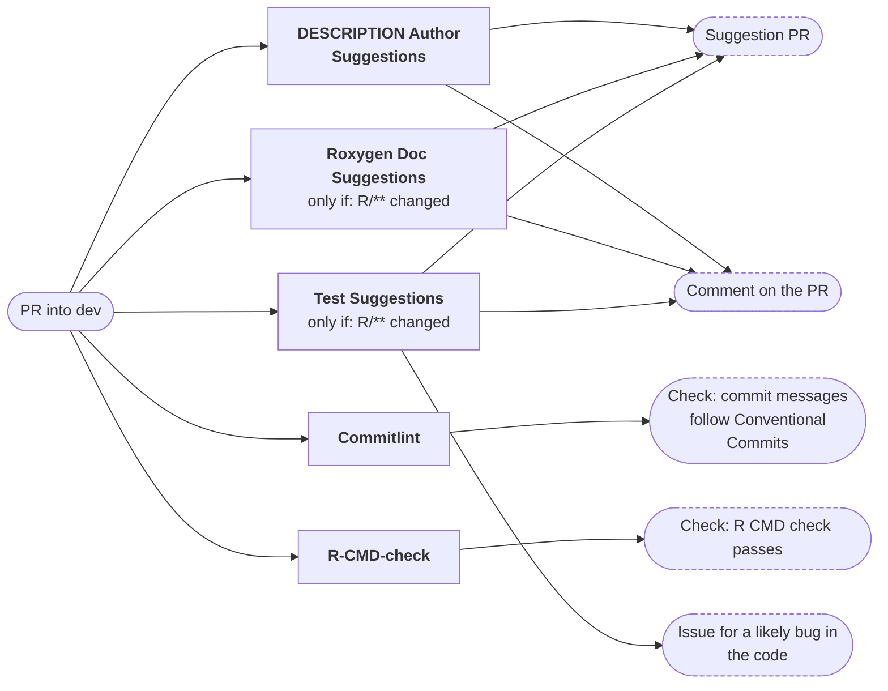
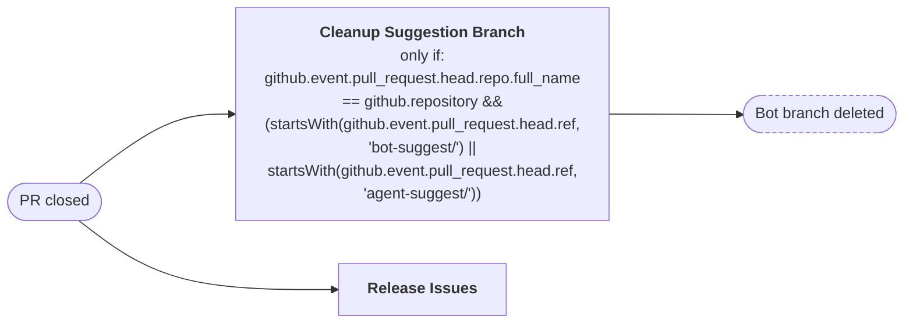
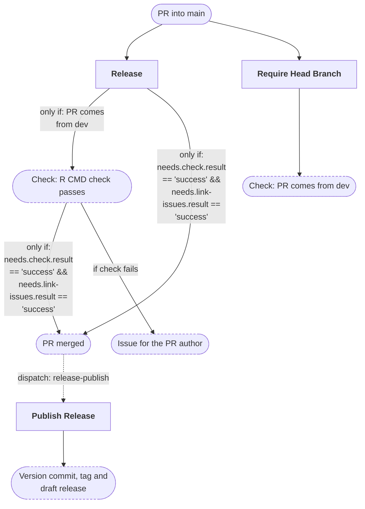
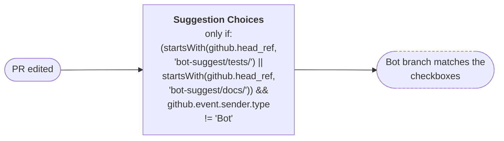
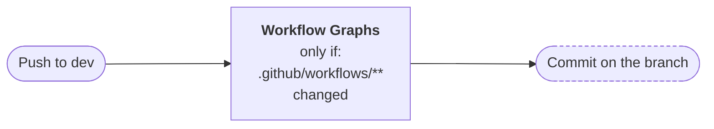
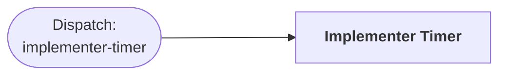
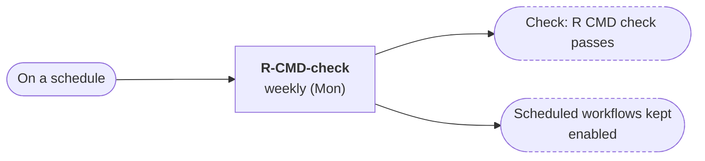
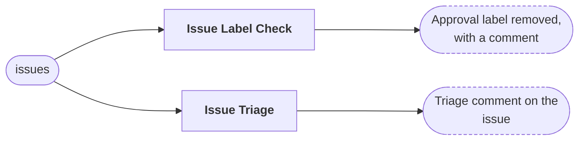
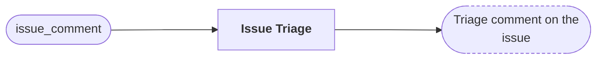

# Workflows

The GitHub Actions workflows of this repository, and how they connect.
The table and diagrams are generated from the workflow files by
[workflow-graphs](https://github.com/FlorianSchw/package-workflows) and
updated when the workflows change. For the details of a workflow, see
its file in `.github/workflows/`. Text outside the marked block is yours
and never overwritten.

<!-- workflow-graphs:overview:start -->
## All workflows

| Name | File | Runs on | Calls | Produces |
|---|---|---|---|---|
| DESCRIPTION Author Suggestions | `authors-suggest.yml` | PR into dev | nfdi4health/datashield-workflows › authors-suggest.yml@main | • Suggestion PR • Comment on the PR — *only if: pull request* |
| Commitlint | `commitlint.yml` | PR into dev | nfdi4health/datashield-workflows › commitlint.yml@main | Check: commit messages follow Conventional Commits |
| R-CMD-check | `R-CMD-check.yaml` | • PR into dev • Weekly (Mon) • Manual run | • nfdi4health/datashield-workflows › r-cmd-check.yml@main • nfdi4health/datashield-workflows › workflow-keepalive.yml@main | • Check: R CMD check passes • Scheduled workflows kept enabled — *only if: scheduled run* |
| Roxygen Doc Suggestions | `roxygen-suggest.yml` | • PR into dev (only if: R/\*\* changed) • Manual run | • nfdi4health/datashield-workflows › roxygen-suggest.yml@main • nfdi4health/datashield-workflows › workflow-keepalive.yml@main | • Suggestion PR • Comment on the PR — *only if: pull request* • Scheduled workflows kept enabled — *only if: scheduled run* |
| Test Suggestions | `test-suggest.yml` | • PR into dev (only if: R/\*\* changed) • Manual run | • nfdi4health/datashield-workflows › test-suggest.yml@main • nfdi4health/datashield-workflows › workflow-keepalive.yml@main | • Suggestion PR • Comment on the PR — *only if: pull request* • Issue for a likely bug in the code • Scheduled workflows kept enabled — *only if: scheduled run* |
| Cleanup Suggestion Branch | `cleanup-suggestion-branch.yml` | PR closed | nfdi4health/datashield-workflows › cleanup-suggestion-branch.yml@main | Bot branch deleted — *only if: github.event.pull_request.head.repo.full_name == github.repository && (startsWith(github.event.pull_request.head.ref, 'bot-suggest/') \|\| startsWith(github.event.pull_request.head.ref, 'agent-suggest/'))* |
| Release Issues | `release-issues.yml` | PR closed | nfdi4health/datashield-workflows › release-issues.yml@main | — |
| Release | `release-trigger.yml` | PR into main | • nfdi4health/datashield-workflows › r-cmd-check.yml@main • nfdi4health/datashield-workflows › release-issues.yml@main • nfdi4health/datashield-workflows › merge-pull-request.yml@main • nfdi4health/datashield-workflows › create-issue.yml@main • nfdi4health/datashield-workflows › trigger-release-publish.yml@main | • Check: R CMD check passes — *only if: PR comes from dev* • PR merged — *only if: needs.check.result == 'success' && needs.link-issues.result == 'success'* • Issue for the PR author — *if check fails* • starts **Publish Release** |
| Publish Release | `release-publish.yml` | Dispatch: release-publish | nfdi4health/datashield-workflows › package-release.yml@main | Version commit, tag and draft release |
| Require Head Branch | `require-head-branch.yml` | PR into main | nfdi4health/datashield-workflows › require-head-branch.yml@main | Check: PR comes from dev |
| Suggestion Choices | `suggestion-choices.yml` | PR edited | nfdi4health/datashield-workflows › suggestion-choices.yml@main | Bot branch matches the checkboxes — *only if: (startsWith(github.head_ref, 'bot-suggest/tests/') \|\| startsWith(github.head_ref, 'bot-suggest/docs/')) && github.event.sender.type != 'Bot'* |
| Workflow Graphs | `workflow-graphs.yml` | • Push to dev (only if: .github/workflows/\*\* changed) • Manual run | nfdi4health/datashield-workflows › workflow-graphs.yml@main | • Commit on the branch — *only if: push* • Note on the PR: runs on push only — *only if: pull request* |
| Implementer Timer | `implementer-timer.yml` | Dispatch: implementer-timer | nfdi4health/datashield-workflows › implementer-timer.yml@main | — |
| Issue Label Check | `issue-label-check.yml` | issues | nfdi4health/datashield-workflows › issue-label-check.yml@main | Approval label removed, with a comment |
| Issue Triage | `issue-triage.yml` | • issues • issue_comment | nfdi4health/datashield-workflows › issue-triage.yml@main | Triage comment on the issue |

## Events

What each event starts: the workflows (bold), what they produce (dashed boxes) and the workflows they start in turn (dotted arrows). **only if:** — happens only under this condition, e.g. when these files changed; **skipped:** — doesn't happen in this case. A label on an arrow applies to that arrow only ("if check fails").

### PR into dev

*When a pull request into dev is opened or updated.*

### PR closed

*When a pull request is closed.*

### PR into main

*When a pull request into main is opened or updated.*

### PR edited

*When a pull request is edited.*

### Push to dev

*On a push to dev.*

### Dispatch: implementer-timer

*When the implementer-timer event is sent.*

### On a schedule

*On a schedule.*

### issues

*issues.*

### issue_comment

*issue_comment.*

<!-- workflow-graphs:overview:end -->
